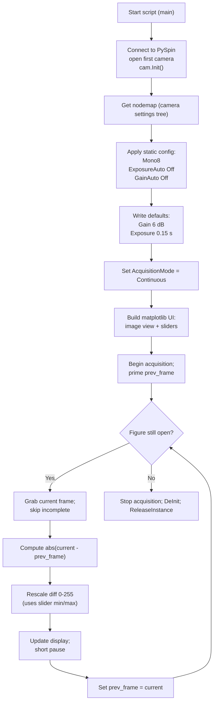
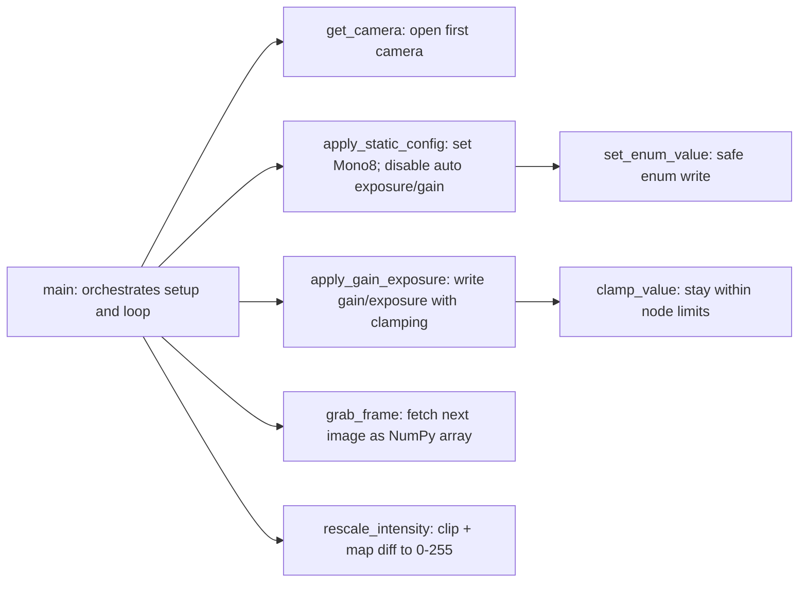

# ESPI Sequential Subtraction (Python) - Overview

This note walks through `espi_sequential_subtraction.py`, an earlier lab script (not included in this repository), explains how the script is structured, and how frames move through the live ESPI difference viewer.

## What the script does
- Opens the first PySpin camera, forces 8-bit mono pixels, and disables auto gain/exposure.
- Builds a small matplotlib UI with sliders for min/max rescale, gain, and exposure.
- Streams frames continuously; each new frame is subtracted from the previous one.
- Rescales the absolute difference into 0-255 for display and shows it live.

## Modules and helpers
- `rescale_intensity(img, min_val, max_val)`: Clips a diff image, linearly maps the chosen range to 0-255, and returns `uint8`.
- `get_camera()`: Grabs the PySpin system instance, opens the first camera, and initializes it; raises if none are found.
- `set_enum_value(nodemap, node_name, entry_name)`: Safe helper to write enumerated node values when readable/writable.
- `clamp_value(node, value)`: Guards against setting gain/exposure outside the node's allowed range.
- `apply_static_config(nodemap)`: Sets pixel format to `Mono8`, turns off `ExposureAuto` and `GainAuto`.
- `apply_gain_exposure(nodemap, gain_db, exposure_seconds)`: Writes gain (dB) and exposure (seconds, converted to microseconds) with clamping.
- `grab_frame(cam, timeout_ms=1000)`: Pulls the next image, drops incomplete ones, and returns a NumPy array copy.

## Control flow at a glance

## Functions working together

## Keywords / definitions
- `nodemap`: The camera's configuration tree; each setting (e.g., exposure, pixel format) is a "node" you read/write through PySpin.
- `enumeration node`: A node that only accepts predefined entries (e.g., `AcquisitionMode` values like `Continuous`).
- `Mono8`: 8-bit grayscale pixel format; one byte per pixel.
- `Gain` / `ExposureTime`: Analog gain (dB) and exposure duration (sent as microseconds) applied in the camera.
- `AcquisitionMode = Continuous`: Camera keeps producing frames until you stop acquisition.

## How the UI ties in
- Matplotlib sliders (`widgets.Slider`) set `Min`, `Max`, `Gain`, and `Exposure (s)`.
- `update_settings` reads slider values, keeps `max > min`, and immediately calls `apply_gain_exposure`.
- The render loop checks if the figure is still open; closing the window exits the loop.

## Live processing loop (plain language)
1) Start grabbing frames in continuous mode.  
2) Keep the most recent frame as `prev_frame`.  
3) For every new frame, compute `abs(current - prev_frame)` to see changes between successive captures.  
4) Map values inside `[min, max]` to full 0-255 grayscale for contrast, clamp outside values.  
5) Show the result in the matplotlib window; repeat with the latest frame.

## Key behaviors and constraints
- Pixel format is forced to `Mono8`; color modes are not supported here.
- Auto gain/exposure are disabled to keep differences stable; sliders provide manual control.
- Exposure is expressed in seconds on the slider but sent to the camera in microseconds.
- Incomplete frames are skipped to avoid corrupt displays.
- Cleanup (`EndAcquisition`, `DeInit`, `ReleaseInstance`) runs even on keyboard interrupt.
